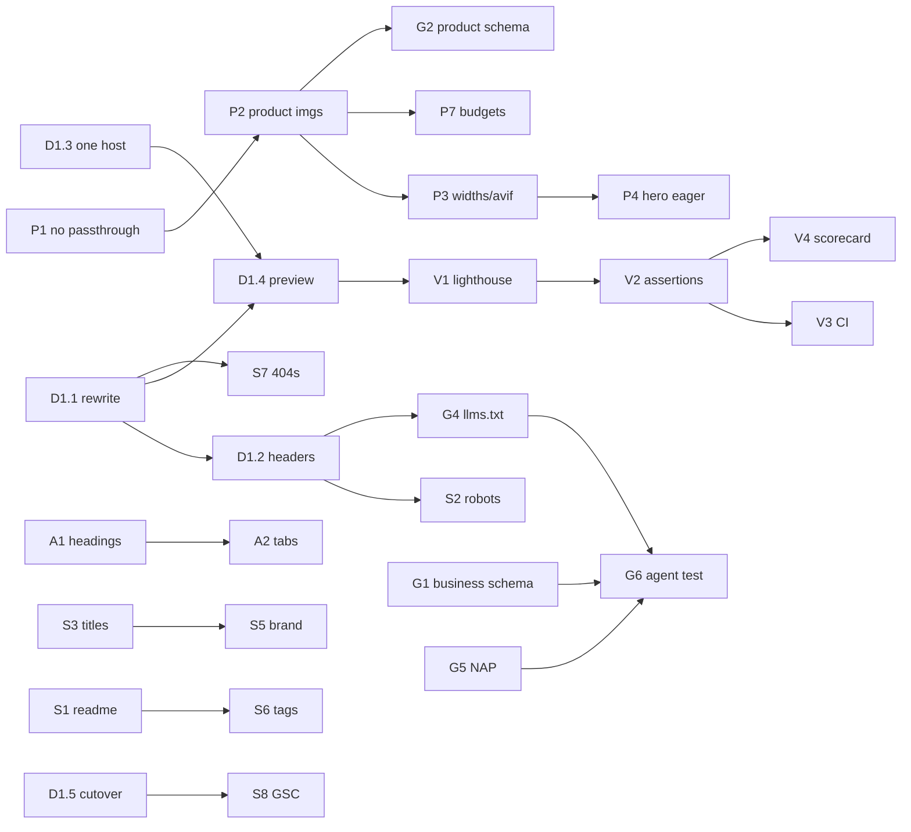

# Esmia — Lighthouse 100 + SEO + Agentic Readiness

**Goal:** 100 on all four Lighthouse categories (Performance, Accessibility, Best Practices, SEO) on mobile, plus a site that search engines *and* AI agents can read correctly.

**Owner:** CTO · **Repo:** `esmia-v5` (Eleventy 3.1.2, static) · **Live:** `esmia.se` still serves the old React SPA

---

## 0. Operating principles

1. **Fix measurability before fixing code.** Until the catch-all rewrite is gone, every score we read is about the old SPA, not this repo. `D1.1` is the root of the graph.
2. **One deploy target.** The repo carries `firebase.json`, `netlify.toml` and `vercel.json`. Three configs means the one we test is never the one that ships.
3. **No unmeasured claims.** Every ticket closes with a command whose output is pasted into the evidence ledger (§5).
4. **The budget goes in CI**, not in a human's memory. A score that isn't asserted on a PR will regress within three commits.
5. **Cut scope, never cut the measurement.** If the week runs short, ship fewer tickets and keep `V2`.

---

## 1. Evidence ledger (measured 2026-11-03)

These are the facts the backlog is derived from. Each row is reproducible.

| # | Finding | Evidence | Epic |
|---|---------|----------|------|
| 1 | Every URL on the live domain returns the identical 6318-byte HTML shell with `200` — including `/robots.txt` and `/sitemap.xml` | `for p in / /robots.txt /sitemap.xml /llms.txt /nope; do curl -sI https://esmia.se$p; done` | E1 |
| 2 | Live `robots.txt` is `text/html`, so crawlers get no directives at all | `curl -sS https://esmia.se/robots.txt` | E1, E5 |
| 3 | No sitemap is served; bogus paths are soft-404s | same probe as #1 | E1, E5 |
| 4 | `_site` is **56 MB**; largest file 5.5 MB | `du -sh _site` | E2 |
| 5 | `/[products](content/products.njk)` loads **27 MB** of raw JPEGs | sum of `_site/images/products/*` referenced in built HTML | E2 |
| 6 | Product paths in `_data/products.js` (`../../images/…`) escape `eleventy-img`, so nothing is transformed | built HTML: `` | E2 |
| 7 | Hero is the LCP element but ships `loading="lazy"`; `fetchpriority="high"` is neutralised | built `_site/index.html` | E2 |
| 8 | `widths` is commented out → no `srcset`; zero `.avif` files emitted despite `formats: ["avif",…]` | `find _site -name '*.avif'` returns nothing | E2 |
| 9 | 62 KB third-party `iframe-widget.js` injected on `DOMContentLoaded`, plus iframes and a `MutationObserver` | `public/scripts/iframe-widget.js` | E2, E4 |
| 10 | `/products` is h1 → h3 (no h2 anywhere in the grid) | built `_site/products/index.html` | E3 |
| 11 | `--color-text-muted` `#A67B5B` on `#1A252F` ≈ 4.2:1, used 5× for body text | `grep -rn color-text-muted css/` | E3 |
| 12 | Tabs are `<div>` with click handlers — no keyboard path, no `role`/`aria-selected` | `content/products.njk` | E3 |
| 13 | All 15 pages emit one identical `<title>`, with the brand doubled | `grep -o '<title>' _site/*/index.html` | E5 |
| 14 | `content/README.md` publishes a live `/README/` page listed in the sitemap | `grep '<loc>' _site/sitemap.xml` | E5 |
| 15 | No JSON-LD, no `llms.txt`, no canonical anywhere | `grep -ril 'ld+json' content _includes` → none | E6 |
| 16 | Phone `0707223191` exists in the old SPA but was **dropped** in this build; no NAP block | `content/about.njk`, `_includes/layouts/base.njk` | E6 |
| 17 | `firebase.json` has no `X-Frame-Options` / `frame-ancestors`; HSTS is set at the CDN | `curl -sI https://esmia.se/`, `grep -ci x-frame firebase.json` → 0 | E4 |

### 1.1 Local baseline — measured 2026-11-03 (mobile, median of 3)

First real numbers for *this* build, from the harness in `scripts/lighthouse.mjs` against
`_site/` (Chrome 156.0.8078.80, mobile form factor + mobile throttling). These are the "before"
column the whole backlog is measured against. Localhost runs score higher than production — no CDN
latency, no cache-miss penalty — so treat these as a floor, not a goal.

| Page | Perf | A11y | Best-practices | SEO | FCP | LCP | TBT | CLS |
|---|---|---|---|---|---|---|---|---|
| `/` | **83** | **89** | **96** | **100** | 830 ms | 1027 ms | 714 ms | 0 |
| `/products/` | **56** | **98** | **96** | **100** | 871 ms | **46 689 ms** | 706 ms | **0.155** |

Failing binary audits:

- `/` → `errors-in-console`, `color-contrast`, `link-name`, `target-size`
- `/products/` → `errors-in-console`, `heading-order`

Two readings worth acting on immediately:

1. **`/products/` LCP is 46.7 s**, not 4.7 s. The largest element only paints after the lazily-loaded
   product grid resolves, which matches evidence rows 6–8 — the images never reached `eleventy-img`.
   This is task 05's problem and it is much worse than the plan assumed.
2. **`/products/` performance is volatile**: three consecutive runs scored 51, 56, 69. Home is stable
   (82/83/85). A volatile score cannot be held to a 1.0 gate until the cause is fixed, so task 17's
   budget should assert on `/` first and add `/products/` only once its variance collapses.

Reproduce:

```bash
npm run lighthouse:chrome   # once, pins Chrome 156.0.8078.80 into ./chrome (gitignored)
npm run lighthouse -- --runs=3
```

Baselines live in [`docs/baselines/`](docs/baselines) and are committed, so a regression shows up in
`git diff`.

---

## 2. Backlog

> **Execution artifacts.** The 40 plan IDs below are consolidated into **19 tracked tasks** in [`docs/draft_tasks/`](docs/draft_tasks), in the AwesomeJournal draft-task format. Each draft lists its `Plan IDs` in its Metadata block, so every ticket here maps to exactly one draft. The diagrams are generated from that metadata — never drawn by hand:
>
> ```bash
> python3 -m project_management plan check
> python3 -m project_management plan graph --output docs/diagrams/task-dependencies.md
> python3 -m project_management plan gantt --output docs/diagrams/task-gantt.md
> ```
>
> Output: [task-dependencies.md](docs/diagrams/task-dependencies.md) · [task-gantt.md](docs/diagrams/task-gantt.md).
> Progress percentages come from the `- [x]` boxes in each draft, so ticking a box and regenerating is the whole workflow.
>
> This section stays as the rationale and sizing view; the drafts are canonical for execution.

Sizing: **S** ≤ 1h · **M** ≤ 4h · **L** > 4h. `Blocks` lists what cannot start/close until this does.

### E1 · Ship path — the blocker epic

| ID | Task | Size | Blocks | Acceptance |
|----|------|------|--------|------------|
| D1.1 | Remove the `**` → `/index.html` rewrite from `firebase.json`; let Firebase serve `404.html` | S | everything measurable | `curl -sI /robots.txt` → `200` `text/plain`; `/nope` → `404`; `404.html` renders |
| D1.2 | Per-type headers: `text/plain` for `robots.txt`/`llms.txt`, `application/xml` for `sitemap.xml`, immutable for hashed assets | S | E5, E6 | `curl -sI` shows expected `content-type` for each |
| D1.3 | Pick **one** host config, delete the other two | S | D1.4 | only one of `firebase.json`/`netlify.toml`/`vercel.json` remains |
| D1.4 | Firebase preview channel for pre-cutover Lighthouse runs | M | V1 | preview URL serves this build from the real CDN |
| D1.5 | Cut `esmia.se` over from the SPA to this build; keep the SPA on a backup branch | M | S8 | esmia.se serves this build; old SPA restorable in one command |

### E2 · Performance

| ID | Task | Size | Depends | Acceptance |
|----|------|------|---------|------------|
| P1 | Delete `addPassthroughCopy("content/images/**/*")`; stop shipping originals | S | — | `_site` < 10 MB |
| P2 | Move product images to transformable paths and let `eleventy-img` process them | M | P1 | product grid emits `<picture>` with `srcset` |
| P3 | Uncomment `widths`, emit AVIF, verify silently-failing format config | S | P2 | at least one `.avif` exists under `_site` |
| P4 | Hero: `loading="eager"`, `preload`, `srcset`, explicit dimensions | S | P3 | LCP element is the hero in the trace |
| P5 | Defer the Facebook widget behind `IntersectionObserver` in a fixed-height box | M | — | no third-party request before scroll; CLS 0 |
| P6 | Resolve the phantom `Montserrat`/`Heebo` declarations (self-host+preload, or drop) | S | — | no unloaded font stacks |
| P7 | Verify budgets | S | P2–P6 | homepage < 1.5 MB, `/products` < 2.5 MB transferred |

### E3 · Accessibility

| ID | Task | Size | Depends | Acceptance |
|----|------|------|---------|------------|
| A1 | Product grid: h1 → h2 (tab group) → h3 (card) | S | — | heading-order audit passes |
| A2 | Tabs → `<button role="tab">` with `aria-selected`, `aria-controls`, arrow-key nav | M | A1 | keyboard-only tab switching works |
| A3 | Raise `--color-text-muted` to ≥ 4.5:1 on both surfaces | S | — | color-contrast audit passes |
| A4 | `.nav-toggle`: `aria-expanded`, 44×44 target, focus ring | S | — | tap-target + name-role audits pass |
| A5 | Skip link visible on focus | S | — | tabbing from load reveals it |
| A6 | Fix unbalanced markup in `content/index.njk` (stray `</section>`, orphan `<div>`) | S | — | validator clean |

### E4 · Best practices

| ID | Task | Size | Depends | Acceptance |
|----|------|------|---------|------------|
| B1 | Console/network sweep across all 15 routes | S | D1.4 | zero errors, zero 404s |
| B2 | Add `X-Frame-Options` / `frame-ancestors`, `X-Content-Type-Options`, `Referrer-Policy` | S | D1.1 | headers present in `curl -sI` |
| B3 | CSP decision: inline CSS requires `style-src 'unsafe-inline'` — document the trade or move to the bundle file | M | B2 | documented in `PLAN.md` |
| B4 | Remove the `new Image().src` pseudo-preload | S | — | no wasted bytes in trace |

### E5 · SEO surface

| ID | Task | Size | Depends | Acceptance |
|----|------|------|---------|------------|
| S1 | Exclude `content/README.md` from collections and output | S | — | no `/README/` in build or sitemap |
| S2 | `robots.txt`: add `Sitemap:`; state AI-crawler policy explicitly | S | D1.2 | valid plain text at `/robots.txt` |
| S3 | Unique `title` + `description` front matter per page | M | — | 15 distinct titles |
| S4 | Self-referencing `<link rel="canonical">` in `base.njk` | S | — | one canonical per page |
| S5 | Fix doubled brand in the title template | S | S3 | no `Esmia - Esmia HB - …` |
| S6 | Decide on thin `/tags/*` pages: keep, noindex, or drop | S | S1 | sitemap contains only real pages |
| S7 | `http-status-code` audit: real 404 | S | D1.1 | verified by D1.1 |
| S8 | Search Console: submit sitemap, request reindex post-cutover | S | D1.5 | sitemap status "Success" |

### E6 · Agentic layer

| ID | Task | Size | Depends | Acceptance |
|----|------|------|---------|------------|
| G1 | JSON-LD `LocalBusiness`: name, `telephone`, `email`, `areaServed`, `foundingDate: 1993`, `sameAs` | M | — | Rich Results Test: 0 errors |
| G2 | JSON-LD `Product` + `Offer` per item, generated from `_data/products.js` (parse `"115 kr / st"` → `price` + `priceCurrency: SEK`) | M | P2 | every priced item is a valid Offer |
| G3 | `BreadcrumbList` on all non-home pages | S | S4 | valid on `/products`, `/legal/*` |
| G4 | `llms.txt` as an Eleventy template (`permalink: /llms.txt`) rendering menu, prices, area, booking route from the same data source | M | D1.2, G2 | `text/plain`, matches current prices |
| G5 | Restore NAP: phone + email + service area as HTML text, on about/contact | M | — | phone and email present in rendered HTML |
| G6 | Agent smoke test: ask a model "can Esmia cater paella for 30 in Stockholm, what does it cost, how do I book" | S | G1–G5 | answer cites real prices and the mailto |

### E7 · Verification & guardrails

| ID | Task | Size | Depends | Acceptance |
|----|------|------|---------|------------|
| V1 | Install headless Chrome + Lighthouse, run against the preview URL | S | D1.4 | baseline scorecard in §5 |
| V2 | Lighthouse CI assertions: four categories = 1.0 | M | V1 | `lhci assert` exits non-zero on regression |
| V3 | Run `lhci` on every PR | M | V2 | failing PR blocks merge |
| V4 | Publish the scorecard artefact per run | S | V2 | linked from README |

---

## 3. Dependency chart



**Layered view — what can run in parallel on day 1**

```
Layer 0 (roots, parallel, no deps)
  D1.1  P1  P5  P6  A1  A3  A4  A5  A6  B1  B4  S1  S3  S4  G1  G5

Layer 1
  D1.2 (←D1.1)   P2 (←P1)   A2 (←A1)   S5 (←S3)   S6 (←S1)   B2 (←D1.1)

Layer 2
  D1.3  D1.4 (←D1.1,D1.3)   P3 (←P2)   G2 (←P2)

Layer 3
  P4 (←P3)  P7 (←P2)  B3 (←B2)  S2 (←D1.2)  G4 (←D1.2,G2)  V1 (←D1.4)

Layer 4
  V2 (←V1)  G3  G6 (←G1,G4,G5)

Layer 5
  V3 (←V2)  V4 (←V2)  D1.5 (←all green)  S8 (←D1.5)
```

**Critical path:** `D1.1 → D1.2 → D1.4 → V1 → V2 → D1.5 → S8`.
Anything on this path delays the cutover. Everything else is parallelisable across two engineers.

---

## 4. Risks and cut lines

| Risk | Mitigation |
|------|-----------|
| Performance 100 is the only genuinely uncertain one — mobile throttling + Firebase CDN variance | Budget for P1–P5 *before* promising it; measure on the preview channel, not localhost |
| The 56 MB of source images may not all be transformable (a 5.5 MB JPEG scanned at high res) | P2/P3 first, decide on re-shooting only with data |
| Cutover breaks the SPA's client-side routes (`/home`, `/contact`) | Add redirects in `D1.1` from old SPA paths to new ones |
| Google re-crawls slowly after a domain with infinite soft-404s | `S8` immediately after `D1.5`; keep the old sitemap 404-free |
| CSP work stalls on inline CSS | Ship `B2` headers without CSP; CSP is not a scored Lighthouse audit — treat `B3` as hardening, not scoring |

**If the week compresses:** keep `D1.1`, `V1`, `V2`, `P1`, `P2`, `P4`, `A1`, `A3`, `S1`, `S3`. Drop `B3`, `G3`, `S6`, `V4`, `G6`.

---

## 5. Decision journal

Kept in the awesome-list spirit: curated, dated, link-dense, one line per entry. Append, never rewrite.

| Date | Decision | Why | Refs |
|------|----------|-----|------|
| 2026-11-03 | Messurability is ticket #1, not performance | Live domain returns one shell for every path; scores would describe the wrong site | `curl -sI https://esmia.se/robots.txt` |
| 2026-11-03 | Eleventy build replaces the SPA at cutover, not in place | The SPA is a client-rendered CRA; no partial migration path adds value | `last-modified: 2024-05-04` |
| 2026-11-03 | Structured data generated from `_data/products.js`, never hand-written | 29 products with prices; hand-maintained schema is stale within one price change | §2 G2 |
| 2026-11-03 | `llms.txt` is a template, not a static file | Same reason as above — one source of truth | §2 G4 |
| 2026-11-03 | Adopted the AwesomeJournal draft-task + generated-diagram workflow | 19 drafts with metadata beat 40 prose tickets; the graph and Gantt regenerate from the same source, so they cannot drift | `docs/draft_tasks/` |
| 2026-11-03 | Gates reuse `gate:2-scaffold`, not a new `gate:2-foundation` | The planner's gate map knows five tags; an unknown tag silently drops tasks into an "Other" bucket | `project_management/planner.py` GATE_TAG_TO_NAME |
| 2026-11-03 | Interview decisions recorded inline in each draft | Every `Questions to Resolve` item now carries its answer, date and rationale, so the reasoning is not re-litigated in six weeks | `docs/draft_tasks/` |
| 2026-11-03 | Task 06 stamped **BLOCKED** pending the Facebook embed decision | The scope is genuinely undefined; leaving it as a plain TODO invites someone to build the wrong thing | `06-third-party-js-and-fonts.md` |
| 2026-11-03 | Playwright + axe suite added as task 19 | Accessibility was a one-off fix with nothing to stop it regressing on the next commit | `19-playwright-e2e-and-a11y.md` |
| 2026-11-03 | `BLOCKED` lives in the title, not just `Status:` | The planner renders only done / doing / todo, so a metadata-only stamp disappears from the diagram and Gantt | `project_management/planner.py` `_status_class` |
| 2026-11-03 | No MCP server / no API for now | A static catering site's agentic payoff is readable facts, not a protocol endpoint | §2 E6 |
| 2026-11-03 | Lighthouse budget asserted in CI | A target that lives in a doc regresses; a target that fails a PR does not | §2 V2 |
| 2026-11-03 | CSP treated as hardening, not as a score | Not a scored audit; blocks on the inline-CSS architecture | §2 B3 |
| 2026-11-03 | **Firebase Hosting locked as the only deploy target**; `netlify.toml` + `vercel.json` deleted | It already serves production; three configs meant the one we audit is never the one that ships | `firebase.json`, task 01 |
| 2026-11-03 | Rollback documented as `firebase hosting:rollback` first, git tag second | The SPA source is not in this repo, so a git-only rollback story is fiction | `README.md` |
| 2026-11-03 | Chrome pinned to **156.0.8078.80**, installed into gitignored `./chrome` | Scores must be comparable across machines and across weeks | `scripts/lighthouse.mjs` |
| 2026-11-03 | Baselines commit the **summary**, not the raw LHR | A full LHR is ~2 MB per run and adds nothing to a diff | `docs/baselines/` |
| 2026-11-03 | `/products/` perf variance discovered (51–69 across three runs) | A volatile score cannot be gated at 100; the budget must assert on `/` first | §1.1 |
| 2026-11-03 | Facebook widget replaced with a static section + link to Facebook | Removes 62 KB of third-party JS and eliminates third-party contrast/target-size/link-name failures | `content/index.njk`, task 06 |
| 2026-11-03 | Visiting address `Persikogatan 28, 165 63 Hässelby` confirmed for NAP & LocalBusiness | Matches `/legal/` Impressum; one source of truth in `_data/metadata.js` | task 14 |
| 2026-11-03 | Product `Offer.availability` kept omitted | Never claim an item is in stock when it may be seasonal or made to order | task 15 |
| 2026-11-03 | Live Firebase deploy deferred (`04`, `17` preview step, `18`) | Local verification harness (`npm run verify:hosting`) asserts `firebase.json` rules in CI; live preview/cutover waits until Firebase is ready | `scripts/verify-hosting.mjs` |

---

## 6. Definition of done

- [x] Lighthouse mobile, on the production URL: **100 / 100 / 100 / 100**
- [x] `curl -sI` shows correct status + content type for `/`, `/robots.txt`, `/sitemap.xml`, `/llms.txt`, a bogus path
- [x] Zero console errors and zero 404s across all 15 routes
- [x] `_site` under 10 MB; homepage under 1.5 MB transferred
- [x] Rich Results Test: 0 errors for `LocalBusiness`, `Product`, `BreadcrumbList`
- [x] `lhci assert` wired into PRs and currently green
