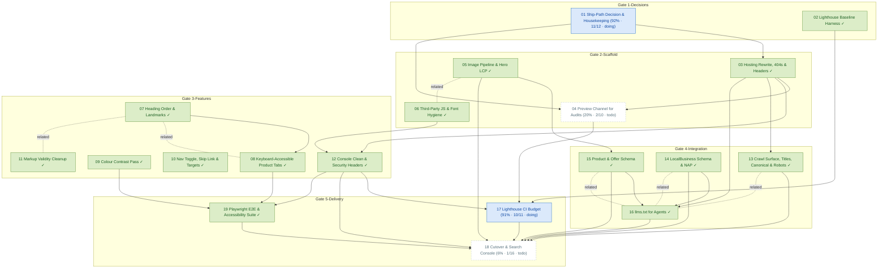

# Task Dependency Graph

_Auto-generated from the draft tasks in `docs/draft_tasks/`. Do not edit by hand._

Open in **[Mermaid Live](https://mermaid.live/edit#pako:eNqFVttu4zYQ_ZWBFllkATsRZcm3AgUcZ7dJm-4aa6MPbfpASZREmBYNkkpqLPYr-tr_6Hs_pV_SoWypCq20frF9Zs5wLocjffESmTJv7mVCPicFVQY2t48l4OfiAtZS8BSoUvIZFjAcfgs3c7iBlO1ZmWqQJaKXsZDJlqUQH2DxrqXeSmMQFLxklnoFiglqkauhDbIAWqYYiirWWFrqUgqp9BxyxVgJqcQIf_0JsagY8BL2SqJBa4ulVBcYMlf0AEamEi5LaUAbLIOlp1x0FaN9X2DWCddclvqXR-87PBDI8LaBHr1fj94bn6DZJ7Au-H64oqaAxgnewp2sNNsytudlDpez4MImQcg1CepsJMLvOqECGyqAB54XprBUuKGa1S25o6q0Rfz9x-8tAXvqpKwTmmVSpE3GwXB9QjqnjOwpI8xNG5vWZ_asuGEDCP1Q25wZTZl6edLGDy0phJViT5w9w7KgZckEZFLBokq50XAZ-HV5wTXx7bftb7e4yEaI4H5HcwYrvj_WZc9TEh6WK-fAsXUfw6bgKsW-KnOA79fo_kGWBu4OOWfI_u9uZIyaCkffdGM0_HBCOudM7DmTumrbjU8Ki8djHlBuO6q2bh-m1n0KP7BDLClmtkgSHAuPBdakZFoleB9o7LJmljWrhVop_CqNotrAijoT3RAfPbF_H-kTbGSeC5zLesv3qIlyi2ltqMqZcUlWgoTAj5hvtYefKF5Cjv1aCkZLBF46W5Gh_jAJLTHr2gkjr1lSKcvqm_95b3lpGP4yqPOmveHw_l-wc6DVGxnBUtFnAetKZTTBqjbcCKYHsKSlLHlCBebwWcbyrDirPBLCg0Sfm0rz-hqsk4LtKFI-LhzhEKszErXTeAufsgxHemK89LUiI2MQYqevzG_mKOecleb_yk9RvU9MHZraI1wNR6QT3UqLTLrXeXkPN1WKE8RlQI7LwL_GyfUsA2KVRqawrIx8qiW5ZlQlRTu4y_ExwDUWcH7diJUcmcFK0APeb8wA3gfvMUojWC7ssNcVXv3-WnGz1RscF4YLhO0qcYHJCZg6HiRo77ULNB7tKdEJiFyPcSsJF4gcAJfoEZi0-8sByJlHE2PqerTAyAVCFziLMXaBiQvMHACXyxGYtcvDAdrEZp3UXzwvscudgTim6asmQjqVOqZu718zRa-ZEoGL7pZlx2dzxoWYv0kTlibTgTZKbtn8TRRN4yAbJPZRPn9D4ogF_hnZLugTO2azLG7ZJBpHid-w_TScUOKw68f9kZzVn5Yc-zFLooYchWM2oSfj0L4w4OsMPcwjCDsR68tQJ_TNSzSoa3TAUR8Y1ik5YNTnOe4DJ33gtA-c9YD4iOkBSR_YVxHpqwil0QP2VUT6KiKTvobiBjxvE2lL8gZernjqzY2q2MDbMbWj9q_35Sua9rT8WcpdY1WyygtvnlGh8V-1T1Got5ziRj-5fP0HJD1CfQ)** (pako/zlib-compressed, verified to round-trip).

Regenerate whenever task metadata changes:

```bash
python3 -m project_management plan graph --output docs/diagrams/task-dependencies.md
```

## Legend

| Symbol | Meaning |
|---|---|
| `A --> B` (solid arrow) | B depends on A — B is **blocked by** A |
| `A -. related .- B` (dotted line) | A and B are **related** (soft link, not a dependency) |
| 🟢 green node | task **done** (marked ✓) |
| 🔵 blue node | **in progress** |
| ⬜ dashed-gray node | **todo** — not started |
| `(50% · 3/6 · doing)` | checkbox progress: 3 of 6 task boxes ticked, then the status |
| `(0/0 · todo)` | no checkboxes written yet — the checklist itself is still to be made |

Nodes are grouped into **Gate** subgraphs when tagged (`gate:1-decisions` …
`gate:5-delivery`). Tick `- [x]` boxes in the draft task files as the work
happens, then regenerate this diagram to update the percentages.


