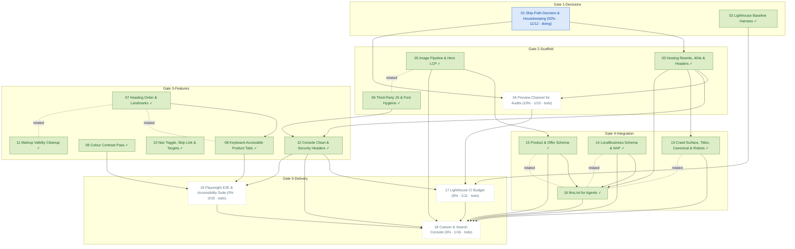

# Task Dependency Graph

_Auto-generated from the draft tasks in `docs/draft_tasks/`. Do not edit by hand._

Open in **[Mermaid Live](https://mermaid.live/edit#pako:eNqFVs1u20YQfpUBDQcKINlcidRfgQKynNRunUSIhB5a97Akl-RCK66wu7QrBHmKXvMevfdR-iSdpUSWXtGtLpK-mW_-Z8gvXiwT5s29VMjnOKfKwOb2sQD8XF7CWgqeAFVKPsMCBoPv4WYON5CwPSsSDbJAtBcJGW9ZAtEBFm8b6q00BkHBC2apV6CYoBa5GlgjC6BFgqaoYrWkoS6lkErPIVOMFZBItPDXnxCJkgEvYK8kCrS2WEJ1jiYzRQ9gZCKhV0gD2mAaLDnFossI5fsco4655rLQvz56P6BDIIPbGnr0fjtqb3yCYp_AOuf7wYqaHGoleAN3stRsy9ieFxn0ZsNLGwQh12RYRSMRftsyNbSmhvDAs9zklgo3VLOqJHdUFTaJv7_90RCwpk7IOqZpKkVSRzwcrE9Iy8vIehlhbNrYsD6zZ8UN60PgB9rGzGjC1EtPGz-wpABWij1x9gzLnBYFE5BKBYsy4UZDj_jH9K6Jb79tfdvJhdZCCPc7mjFY8f0xL-tPSXhYrhyHY6s-hk3OVYJ1VeYAP65R_b0sDNwdMs6Q_d_VSBk1Jba-rsZo8P6EtPxMrJ9JlbWtxieFyaObBxy3HVVbtw5Tqz6Fn9ghkhQjW8QxtoVHAnNSMilj3AcauayZZc2qQS0VfhVGUW1gRZ2OboiPmli_j_QJNjLLBPZlveV7nIlii2FtqMqYcUl2BAmBDxhvuYefKS4hx3otBaMFAi-V7ZDh_GEQWmLUlRJaXrO4VJbV1f_z2vLCMPxlcM7r8gaD-3_BlkM7b2QES0WfBaxLldIYs9pwI5juw5IWsuAxFRjDZxnJs-Ts5JEAHiTq3JSaV2uwjnO2o0j5uHAGh9g5I2HTjTfwKU2xpSfGS107ZGQMQuz0lfndHMc5Y4X5v_QTnN4npg517iGehiPSsm5Hi0za67y8h5sywQ7iMaiXhXQsC7FjRqawLI18quZxzaiK86ZrvXFNH3fR7byRGawEPeByo3t4N3yHVupp5cJ2el3i3kPvuLb-NRLOTDWZ452r7jmeDxcImsPiApMTMHU0yLDZcheoNRov4QkIXY1xMyAuEDoAntQjMGmumQOQM43axtTVaICRCwQucGZj7AITF5g5AJ6aIzBrTokDNIHNWqG_eHpilVsNcUTTV0WEtDJ1RO3avyYKXxPFAs_eLUuPT-qUCzG_SGKWxNO-Nkpu2fwiDKfRMO3H9sE-vyBRyIb-Gdme6xM7YrM0atgkHIexX7P9JJhQ4rCrh_-RnFafhhz5EYvDmhwGYzahJ-HAvj7gyw09zEMIWharZagC-u4lOqxydMBRFxhUITlg2KU57gInXeC0C5x1gPjA6QBJF9iVEenKCEejA-zKiHRlhKtxXhC8iB3grAa9vpcpnnhzo0rW93ZM7aj96335iqI9LX6RcldLlSyz3JunVGj8V-4TnNNbTvG8n1S-_gOfNUX6)** (pako/zlib-compressed, verified to round-trip).

Regenerate whenever task metadata changes:

```bash
python3 -m project_management plan graph --output docs/diagrams/task-dependencies.md
```

## Legend

| Symbol | Meaning |
|---|---|
| `A --> B` (solid arrow) | B depends on A — B is **blocked by** A |
| `A -. related .- B` (dotted line) | A and B are **related** (soft link, not a dependency) |
| 🟢 green node | task **done** (marked ✓) |
| 🔵 blue node | **in progress** |
| ⬜ dashed-gray node | **todo** — not started |
| `(50% · 3/6 · doing)` | checkbox progress: 3 of 6 task boxes ticked, then the status |
| `(0/0 · todo)` | no checkboxes written yet — the checklist itself is still to be made |

Nodes are grouped into **Gate** subgraphs when tagged (`gate:1-decisions` …
`gate:5-delivery`). Tick `- [x]` boxes in the draft task files as the work
happens, then regenerate this diagram to update the percentages.


