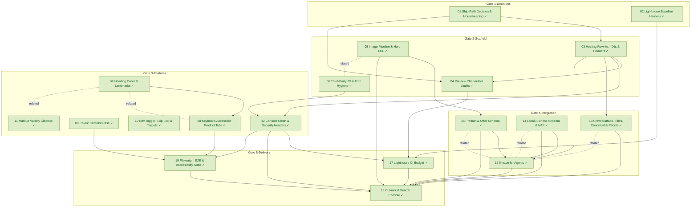

# Task Dependency Graph

_Auto-generated from the draft tasks in `docs/draft_tasks/`. Do not edit by hand._

Open in **[Mermaid Live](https://mermaid.live/edit#pako:eNqFVt1u2zYUfpUDBS06wA5MW_LfgAGO0y7pstaojV1s2QUlUhJhmjRIKplR9Cl22_fo_R5lT7JD29IURtl8k_g733d4Pp5D0p-jTDMezaNc6sespMbB5vpeAX5evYK1loIBNUY_wgL6_R_gag5XwPieK2ZBK0TfpFJnW84gPcDiu0Z6rZ1DUArFvfQSDJfUI5d9n2QBVDFMRQ2vI410qaU2dg6F4VwB05jhr2-QyoqDULA3GgPWeoxRW2LKwtADOM00vFHagXVog7NzLbZKMb4vsepMWKGV_e0--hEXBNK_rqH76PcTezMgGB4QWJdi319RV0JNgtdwoyvLt5zvhSrg769_tmRDLxvCnShKV3oaXFHLj_ZvqFG-4LYA9y8oz2Y0z7VkdXXD_vqMtFYZ-VVGWId1voRP_NEIx3sQD2Lr6-OUcWOD0mIvimFl-IPgj7AsqVJcQq4NLComXMhPPD-B2x0tOKzE_uTCZzca7pargD729DFsSmEY7phxB3i_Rvo7rRzcHArBUf3f3nNOXYVNrb2P-u_OSGudiV9ncvTovX80aBWXucNB2lGzDV1MPX0KP_FDqilWtsgybIJIJXoymlUZTjpNQ9XMq2bHEawM_lHOUOtgRYP-bcgAmWQAH-gDbHRRSOzCeiv2OAFqi2VtqCl4uLXEDxch8DPWW-3hF4rHS-B-LSWnCoGnZD9SZOiLsBqrPpIw85pnlfGqrm4_31uhHMf_HE5wvb1x__ZfsLWgny4ygqWhjxLWlclphq42wklue7CkSiuRUYk1fNKpfmbOzxmJ4U4j56qy4jj066zkO4qSD4tgcIifM5I03XgNH_McW3pWPOX6ISNjkHJnL90f7jS8BVfu_-wznN4Hbg619wQP_QlpZfejRSbtw7u8hauKYQeDOvxUkSksK6cfjuO35tRkZdOkp2w_TWQGK0kPeFAxObwdvkVRPYtC-j6uKzzD3TbwOjpeu3jyQyBu7oQQmJyBacAgw-bIhkDNaFZJzkASMsZNt0MgCQC8DU_ApLmIAoA8Y9Q5piGjAUYhEIfAsxzjEJiEwCwA8N44AbPmXgiAprBZq_QnjxzucqshQWj6YoiQltMg1N77l0LJS6FM4h12zfPTg5oLKecXLOMsm_asM3rL5xdJMk2HeS_z7-_8gqQJHw6eif3de1anfJanjZok4yQb1OoBiyeUBOrjG30S58dPI04HKc-SWpzEYz6h52Dfv_L4G4Qe5gnErYzHw-DdfP8UHHaBoy4w7gKTLnDcBU66wGkXOOsA8fHoALsckS5HpMsR6XJEuhyRLkekyxHpckQaR1EvKoxg0dyZiveiHTc76r9Gn79gaE_Vr1rv6qjRVVFG85xKi9-qPcMxvRYUr-oz5cs_begtwQ)** (pako/zlib-compressed, verified to round-trip).

Regenerate whenever task metadata changes:

```bash
python3 -m project_management plan graph --output docs/diagrams/task-dependencies.md
```

## Legend

| Symbol | Meaning |
|---|---|
| `A --> B` (solid arrow) | B depends on A — B is **blocked by** A |
| `A -. related .- B` (dotted line) | A and B are **related** (soft link, not a dependency) |
| 🟢 green node | task **done** (marked ✓) |
| 🔵 blue node | **in progress** |
| ⬜ dashed-gray node | **todo** — not started |
| `(50% · 3/6 · doing)` | checkbox progress: 3 of 6 task boxes ticked, then the status |
| `(0/0 · todo)` | no checkboxes written yet — the checklist itself is still to be made |

Nodes are grouped into **Gate** subgraphs when tagged (`gate:1-decisions` …
`gate:5-delivery`). Tick `- [x]` boxes in the draft task files as the work
happens, then regenerate this diagram to update the percentages.


