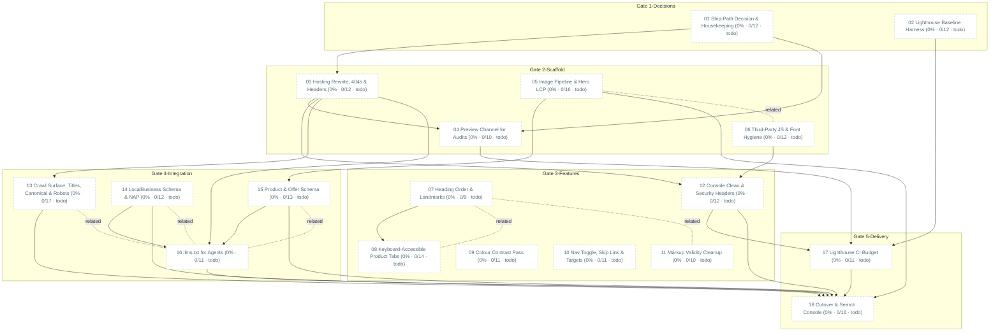

# Task Dependency Graph

_Auto-generated from the draft tasks in `docs/draft_tasks/`. Do not edit by hand._

Open in **[Mermaid Live](https://mermaid.live/edit#pako:eNqVVttu4zYQ_ZWBgiyygJ2KtmQ7LlDAcbBNtumusTb60KYPlEhJhGXSIKmkxmK_q-_9sg5tS6vITNL6xfYZnjMXzoz0NUgV48E0yEr1lBZUW1jdPEjAz_k5LFUpGFCt1RPMoN__Ca6ncA2Mb7lkBpRE9CIpVbrmDJIdzN431BtlLYKlkNxRL0Hzkjrksu9EZkAlQymqeW1pqHNVKm2mkGvOJTCFCv_8DUlZcRAStlqhwRiHMWoKlMw13YFVTMGFVBaMxTQ4O8ZiqgTt2wKjToURSpo_HoKf0SGQ_k0NPQR_Hk6vQoLmkMCyENv-gtoC6kPwDm5VZfia862QOVyE5y6G8AcycN_O__uWzsDpDOBe5IUtHA-uqeH7etxSLV0GrypghTsJmJRmmSpZHf-gvzwiLbdD53aIkRrrgvzCn7SwvAdRGBmXAaeMa_NW8JFTiWCh-aPgTzAvqJS8hExpmFVM2LZA6BOInUAMdxuac1iI7SFx518ruJ8vWvyRjz9y_BGsCqEZXoO2O_i4RP4HJS3c7nLBUe5_1i_j1FbYOnX9hv0PR6TleOwcj_d1cvX7rLFc6Pce23VD9bqV-JUv7omjT-AXvksUxdBnaYo3LZISq6AVq1KcL5q0yxf5ZK6czNV-EiqNX9Jqaiws6LOuIR4qCZGKd_KJPsJK5XmJd79ciy02olxjIiuqc27fVHFTgJZfMeVqC79R3AMC72BecioReP32iet9vBOM2yjMfM9C30ueVtrJ_KcuPL1AIS3HXxaHsb7DqH_3HWxF4MaADGGu6VMJy0pnNMVCrIQtuenBnEolRUpLDOqLStSzeox9GbmBwKu6V0i6rozYz-8yLfiGosan2eKNiSJuIEjcNME7-Jxl2FlHie_koY_spgHnpCw35tL-ZQ9zmHP51j2elpDhID5yvavrF-MOPCAtd24GsAyt1TW_g-uKYeO81Teu_8kE5pVVj_vBWXKq06JphVfHvgkXt_D-aYPrrAtEzaLrAuMjMOmcIINmqXSB-kTjJT4CcffEqGmELhB3ANz5B2DcLNMOQE5O1BqT7okGGHaBqAucaIy6wLgDOLfPnstYoVYxO6bJiyZCWlF2TO26vWSKXzKlJe67G54d3gEyUZbTM5Zylk56xmq15tOzOJ4kg6yXuleG6RlJYj4IT8hukR_ZCb_KkoZN4lGchjU7ZNGYkg57_1pxIGf7T0NOwoSncU2OoxEf06Ox715M8LWJ7qYxRC3FfSM7yR-fgwMfOPSBkQ-MfeDIB4594MQHXnlA3PYe0JcR8WVEfBkRX0bElxHxZUR8GZEmo6AX5FqwYGp1xXvBhusNdX-Dr9_QtKXyd6U2tVWrKi-CaUZLg_-qLcOOvBEUN-fxyLd_AV0KV6s)** (pako/zlib-compressed, verified to round-trip).

Regenerate whenever task metadata changes:

```bash
python3 -m project_management plan graph --output docs/diagrams/task-dependencies.md
```

## Legend

| Symbol | Meaning |
|---|---|
| `A --> B` (solid arrow) | B depends on A — B is **blocked by** A |
| `A -. related .- B` (dotted line) | A and B are **related** (soft link, not a dependency) |
| 🟢 green node | task **done** (marked ✓) |
| 🔵 blue node | **in progress** |
| ⬜ dashed-gray node | **todo** — not started |
| `(50% · 3/6 · doing)` | checkbox progress: 3 of 6 task boxes ticked, then the status |
| `(0/0 · todo)` | no checkboxes written yet — the checklist itself is still to be made |

Nodes are grouped into **Gate** subgraphs when tagged (`gate:1-decisions` …
`gate:5-delivery`). Tick `- [x]` boxes in the draft task files as the work
happens, then regenerate this diagram to update the percentages.


