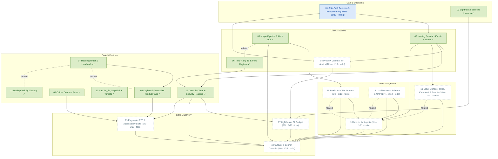

# Task Dependency Graph

_Auto-generated from the draft tasks in `docs/draft_tasks/`. Do not edit by hand._

Open in **[Mermaid Live](https://mermaid.live/edit#pako:eNp9Vt1u2zYUfpUDBylcwE5EW7IkDxjgOO2SLW2N2tjFll1QEiURpkWDopIZRZ9it32P3e9R9iQ7lC1NoZX6xvZ3znf--PFIXwaxTNhgPkiFfI5zqjRsbh8LwM_lJayl4AlQpeQzLGA8_hFu5nADCduzIilBFogOIyHjLUsgOsDibUu9lVojKHjBDPUKFBPUIFdjE2QBtEgwFFWssbTUpRRSlXPIFGMFJBIj_PM3RKJiwAvYK4mGsjRYQsscQ2aKHkDLRMKwkBpKjW2w5FRLWUVo3-dYdcxLLovy98fBT5gQyPi2gR4Hfxy9Nw5Bs0NgnfP9eEV1Do0TvIE7WZVsy9ieFxkMw8mlKYKQazKpq5EIv-2EmphQE3jgWa5zQ4UbWrJ6JHdUFaaJf7_91RJwplbJZUzTVIqkqXgyXp-QTpapyTLF2kptyvrMnhXXbASu45amZkYTpl5m2jiuIbmwUuyJs2dY5rQomIBUKlhUCdclDIlzbO-aOObbzLfbnGcieHC_oxmDFd8f-zL5lISH5cpKODPuM9jkXCU4V6UP8PMa3d_LQsPdIeMM2d-fRsqorvDom2lMx-9PSCePb_L4dddmGp8UNo9pHlBuO6q29hwC4x7AL-wQSYqVLeIYj4VHAntSMqlivA80slmhYYW1UCuFX4VWtNSwotaJboiDnji_j_QJNjLLBJ7Lesv3qIlii2VtqMqYtklGgoTAB6y32sOvFC8hx3ktBaMFAi-djchQf1hEKbHq2gkjr1lcKcPqO__z2fJCM_ylUefNeN3x_f9gJ6HRG5nCUtFnAetKpTTGrjZcC1aOYEkLWfCYCqzhs4xkraSgVtL0mvg9SiJGi8SFB4msm6rk9cVYxznbUQzycbHCCH4dYXK6aXYEo0XitSf2Bj6lKR77KcYwaIQ87SMbZZIZCLErr_Sf-ngHMlaYysOGSc6Z50NM8A48MXVoJujhgjkinXRGoDiHzlJY3sNNlaAOvp9vQ4xYSQDLSsunWtVrRlWct2c_nDX0WR_dqJaEsBL0gCsC08O7yTuM0mieC6OXdYXbA4bHy-9cI-H1znFb1k8FXEI24LbryQb8ExBYHmTS7gobaDzaLN4J8GyPWSsqG_AsABfzEfDbnWgB5MyjiRHYHi0wtQHXBs5izGzAt4HQAnBhHYGwXUgW0BYWdkp_8QzGKXcOxDIFr5oI6XRqmbqzf83kvWaKBS7PW5Yen_cpF2J-kcQsiYNRqZXcsvmF5wXRJB3F5vVgfkEij02cM7JZ-id2xMI0atnEm3mx07CdxPUpsdj1K8SRnNaflhw5EYu9huy5M-bTk3FsXkLwFYke5h64nYj1ZagL-uElOql7tMBpH-jWJVmg1-c56wP9PjDoA8MeEB9bPSDpA_s6QoGcF0_6OkJR9ICzPtDvA4M-MGzAwWiQKZ4M5lpVbDTYMbWj5u_gy1c07Wnxm5S7xqpkleWDeUpFif-qfYI6veUU1_vJ5et_fb5YxA)** (pako/zlib-compressed, verified to round-trip).

Regenerate whenever task metadata changes:

```bash
python3 -m project_management plan graph --output docs/diagrams/task-dependencies.md
```

## Legend

| Symbol | Meaning |
|---|---|
| `A --> B` (solid arrow) | B depends on A — B is **blocked by** A |
| `A -. related .- B` (dotted line) | A and B are **related** (soft link, not a dependency) |
| 🟢 green node | task **done** (marked ✓) |
| 🔵 blue node | **in progress** |
| ⬜ dashed-gray node | **todo** — not started |
| `(50% · 3/6 · doing)` | checkbox progress: 3 of 6 task boxes ticked, then the status |
| `(0/0 · todo)` | no checkboxes written yet — the checklist itself is still to be made |

Nodes are grouped into **Gate** subgraphs when tagged (`gate:1-decisions` …
`gate:5-delivery`). Tick `- [x]` boxes in the draft task files as the work
happens, then regenerate this diagram to update the percentages.


