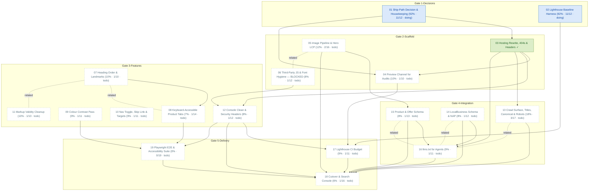

# Task Dependency Graph

_Auto-generated from the draft tasks in `docs/draft_tasks/`. Do not edit by hand._

Open in **[Mermaid Live](https://mermaid.live/edit#pako:eNqVVtuO2zYQ_ZWBFhs4gL1rypJvBQr4sulusskasdGHdvtASZREmBYNitqtEQToP6SP_Y--91PyJR1KlqLI2hr1i6wznMM5w5kRP1m-DJg1tUIhn_2YKg2b5WMC-Lu8hLUUPACqlHyGGfR6P8J8CnMI2J4lQQoyQbTjCelvWQDeAWavK9el1BpBwRNmXK9AMUENctUzJDOgSYBUVLHSUrkupJAqnUKkGEsgkMjwz9_giYwBT2CvJBrS1GABTWOkjBQ9gJaBhE4iNaQaZbDgGEuaeWjfxxi1z1Muk_TXR-sn3BBIb1lCj9ZvxepNn6C5T2Ad831vRXUM5SJ4BbcyS9mWsT1PIuhM7EsTBCHXxM6jkQi_rlHZhsqGex7FOjauMKcpy1NyS1ViRJwjwTw3ZKQ-DUMpglKF3VsfkdrOA7PzAONNtQn1I3tWXLMuOH0nNToYDZhK4etfX2pOjnFyYKXYE2fPsIhpkjABoVQwywKuMVrSL6K9Jn3zNDmvC3YNgwt3OxoxWPF9odXspyTcL1ZIUMi1r8mwjWBoCIawibkKMPtKH-DtGgneyETD7SHiDPm-_vEnzO8fFu9ultAZlwHZp3ynyQsZ1RlWT5m8Qe_NEakFMTJBjPIkmeQ9KMwVxnCPFbujans-DWNDMIZ37OBJikJmvo9nzT2BSVEyyHxsMuohz6ikcdpoJoZmkrdDpvCRaEVTDSua103pSlpcSR9dMbYP9Ak2MooEHv16y_dYiskWpWyoipg-y2JaAS3vUXS2h58pDgOOJ7IQjCYInEkDMeWPx4KBpxKl5264-Zr5mTI8ZRX-zzPkiWb4T2NLlsfo9O6-gbUITBuQASwUfRawzlRIfczEhmvB0i4saCIT7lOBQX2UnswLvIhlcE1GbZJMi-Bh3Uv0mmcpz3t47cdsR5Hkw2z132I2xHQIcasyeAUPYYjVdaT45jxoczbdgX0jxC690r_rojMjlpw7ydMcBtiZT0wdygS6OAoLpLad6QNMQ218Le5gngVYOucqx3QAGcMi0_Ipb541o8qPq1roDEv3tjFATOWTCawEPeDgwu3hxr5BlrKRuDD1s85wpkGnKML-NTq8rBznev79wtHYBJxqaDaB0REYN1YQu5pXTaBcUe3iHgG3uWJY1VQTcBsAfkIKYFRN6gZATlaUHOPmigoYNAGnCZxwDJvAqAlMGgBOwQKYVEOtAVSBTWqhf3dbwCzXDqRhGr9oIqSmtGGq5_4lk_uSyRc4gJcsLG4mIRdiehH4LPDH3VQruWXTC9cde3bY9c1FZnpBPJfZ_RNn8205entsEnqVN3GHrt8vvfuBM6Kk4Z1fdgrnMP9Vzl7fY75bOrvOkI3o0dgz1yW8zNHD1AWnxpg3Qx7QD9-jdis6yJU3QCePqQG6beCwDRy1geM2cNIC4venBSRtoN0GDtrANkWkTRFpU0TaFJE2RaRSZHWtSPHAmmqVsa61Y2pHzav16TOa9jT5RcpdaVUyi2JrGlKR4lu2D7BQl5zifD8u-fwvZZGHrg)** (pako/zlib-compressed, verified to round-trip).

Regenerate whenever task metadata changes:

```bash
python3 -m project_management plan graph --output docs/diagrams/task-dependencies.md
```

## Legend

| Symbol | Meaning |
|---|---|
| `A --> B` (solid arrow) | B depends on A — B is **blocked by** A |
| `A -. related .- B` (dotted line) | A and B are **related** (soft link, not a dependency) |
| 🟢 green node | task **done** (marked ✓) |
| 🔵 blue node | **in progress** |
| ⬜ dashed-gray node | **todo** — not started |
| `(50% · 3/6 · doing)` | checkbox progress: 3 of 6 task boxes ticked, then the status |
| `(0/0 · todo)` | no checkboxes written yet — the checklist itself is still to be made |

Nodes are grouped into **Gate** subgraphs when tagged (`gate:1-decisions` …
`gate:5-delivery`). Tick `- [x]` boxes in the draft task files as the work
happens, then regenerate this diagram to update the percentages.


