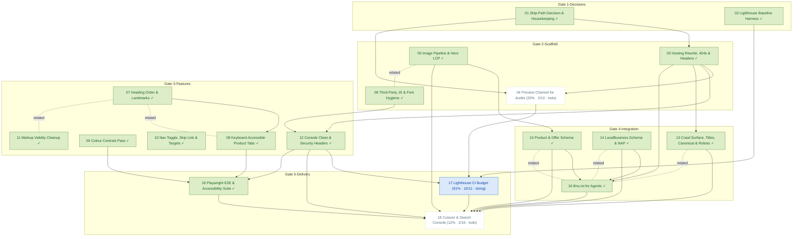

# Task Dependency Graph

_Auto-generated from the draft tasks in `docs/draft_tasks/`. Do not edit by hand._

Open in **[Mermaid Live](https://mermaid.live/edit#pako:eNqFVttu4zYQ_ZWBgiyygJ0VZcm3AgUcZ7dJm-4aa6MPbfpASZREmBYNkoprLPYr-tr_6Hs_pV_SoWypCqO0frF9Zs5wLocjffESmTJv7mVCHpKCKgOb28cS8HN5CWspeApUKXmABQyH38LNHG4gZXtWphpkiehVLGSyZSnER1i8bam30hgEBS-ZpV6DYoJa5HpogyyAlimGooo1lpa6lEIqPYdcMVZCKjHCX39CLCoGvIS9kmjQ2mIp1QWGzBU9gpGphKtSGtAGy2DpORddxWjfF5h1wjWXpf7l0fsODwQyvG2gR-_Xk_fGJ2j2CawLvh-uqCmgcYI3cCcrzbaM7XmZw99__N6hBZYWwAPPC1NYN7ihmtXl31FV2oS7BOyfk55OaJZJkTbZBcP1GemcMrKnjDAPbWwKn9lBccMGEPqhtvkxmjKlndRCSwphpdgTZwdYFrQsmYBMKlhUKTcargL_0vYzeEd8-217-bYTIbIRIrjf0ZzBiu9PddnzlISH5co5cGzdx7ApuEqxh8oc4fs1un-QpYG7Y84Zsv-7GxmjpsIxN90YDT-ckc45E3vOpK7aduOTwuLxmAeU1o6qrduHqXWfwg_sGEuKmS2SBMfCY4E1KZlWCWqfxi5rZlmzWpSVwq_SKKoNrKgz0Q3x0RP795E-wUbmucC5rLd8j5oot5jWhqqcGZdk5UYI_Ij5Vnv4ieKF49ivpWC0ROC5sxUZCWwSWmLWtRNGXrOkUpbVN_-XveWlYfjLoKab9obD-3_BzoFWb2QES0UPAtaVymiCVW24EUwPYElLWfKECszhs4zli-Ks8kgIDxJ9birN62uwTgq2o0j5uHCEQ6zOSNRO4w18yjIc6Znx3NeKjIxBiJ2-Nr-Zk5xzVpr_Kz9F9T4xdWxqj3ANnJBOdCstMule5-U93FQpThCuZqS-LcR_h5Oza0ii_Dr3hVilkSksKyOfakmuGVVJ0Q7uigTNfRv33DdiNUdmsBL0iBccU4D3wXsM0yiWCzvtdYV3v79YXGP1usaN4QJhu0tcYHIGpo4HCdqL7QKNR3tKdAYi12PcasIFIgfALXoCJu0CcwDywqOJMXU9WmDkAqELvIgxdoGJC8wcALfLCZi128MB2sRmndSfPRyxy52BOKbpqyZCOpU6pm7vXzNFr5kSgZvulmWnB3HGhZhfpAlLk-lAGyW3bH4RRdM4yAaJfW7PL0gcscB_QbYb-syO2SyLWzaJxlHiN2w_DSeUOOz62X4iZ_WnJcd-zJKoIUfhmE3o2Ti0bwf47kKP8wjCTsT6MthqvnkOBn3gqA8M64wcMOrzHPeBkz5w2gfOekB8xPSAfRWRvopIX0WojB6wryLSVxGZnAbsoNOeNpG2JG_g5Yqn3tyoig28HVM7av96X76iaU_Ln6XcNVYlq7zw5hkVGv9V-xR1esspbvSzy9d_AMt4PPk)** (pako/zlib-compressed, verified to round-trip).

Regenerate whenever task metadata changes:

```bash
python3 -m project_management plan graph --output docs/diagrams/task-dependencies.md
```

## Legend

| Symbol | Meaning |
|---|---|
| `A --> B` (solid arrow) | B depends on A — B is **blocked by** A |
| `A -. related .- B` (dotted line) | A and B are **related** (soft link, not a dependency) |
| 🟢 green node | task **done** (marked ✓) |
| 🔵 blue node | **in progress** |
| ⬜ dashed-gray node | **todo** — not started |
| `(50% · 3/6 · doing)` | checkbox progress: 3 of 6 task boxes ticked, then the status |
| `(0/0 · todo)` | no checkboxes written yet — the checklist itself is still to be made |

Nodes are grouped into **Gate** subgraphs when tagged (`gate:1-decisions` …
`gate:5-delivery`). Tick `- [x]` boxes in the draft task files as the work
happens, then regenerate this diagram to update the percentages.


