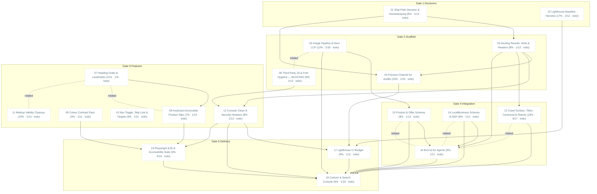

# Task Dependency Graph

_Auto-generated from the draft tasks in `docs/draft_tasks/`. Do not edit by hand._

Open in **[Mermaid Live](https://mermaid.live/edit#pako:eNqNVu-O4jYQf5URqz1xEuzGkBCgUiX-7HX3bnuLDtQP7faDkziJhYmR4yxFp5P6EH2Xfu-j9Ek6DiTHBe9RvoT8xvPz_MYzE39uhTJirXErFnIXplRpWM2fM8Df9TUspeARUKXkDibQ7f4I0zFMIWJblkU5yAzRdiBkuGYRBHuYvK1d51JrBAXPmHG9AcUENchN15BMgGYRUlHFKkvtOpNCqnwMiWIsg0giwz9_QyAKBjyDrZJoyHODRTRPkTJRdA9aRhLamdSQa5TBomMseRGgfZti1CHPuczy355bP-GGQLrzCnpu_X5YvXIImh0Cy5RvuwuqU6gWwRu4l0XO1oxteZZAe3htYiC3pGeeZv-3Jzw9w9ODR56kOjV-MKU5K_NxT1VmFLSJX1L0rBSY4oaCPKRxLEVUCeh1l0fkZN--2bePoebaRPmJ7RTXrAOu4-ZGAqMRU_ml6F3D4sJCsRfOdjBLaZYxAbFUMCkirk3wTsXg2Bg8w-DBw4YmDBZ8e5BuAlASHmcLJOhV6gc2goEhGMAq5SrCk1B6D--XSPBOZhru9wlnyPfvn3_B9PFp9uFu_n1J59mMGdUFVlKVzX733RE5CcI3Qfhl1kw2nxQmD2N4xOrdULU2aSDHXUc2EUPjP4QPbB9IijomYYgnzwOBOVEyKkLsNxogjV_F7tpoRoZmVHZGofCRaUVzDQtqqmhUuRKLK3HQFU_oI32BlUwSgaWwXPMtFma2RiUrqhKmL7KYrkDLz6i52MIvFOcCxwOZCUYzBC4UAzHNgKeCgecSpZduuPmShYUyPP-rKs-PkGea4T-N3Vmdott9-AqeRGDagvRhpuhOwLJQMQ0xEyuuBcs7MKOZzHhIBQb1SQayrO9DLP1b4tskmQ7Bw3qU6DUtcl529DJM2YYiycfJ4kKLEdMgxKvL4A08xTEW15Hiq3Pf5myaA9tGiE1-o__Qh8ZMWHbpJM9zGGFjvjC1rxLo4VQ8ICfbmTbANJwMs9kDTIsIS-dS5ZgOIEOYFVq-lL2zZFSFaV0L7UHlbpsCxFQ-GcFC0D0OMtwe7np3yFI1EhemfpYFzjhoH4rQuSWj7yjHEV9-ynBUNgG3HqJNwD8Cw8YK0qvHVROoVtS7eEfAa64Y1DXVBLwGgB-UA-DXg7oBkLMVFcewuaIG-k3AbQJnHIMm4DeBUQPAKXgARvVQawB1YKOT0L-5OGCWTw6kYRq-aiLkRGnDdJr710zea6ZQ4ACes_hwSYm5EOOrKGRROOzkWsk1G1953jDoxZ3Q3GnGVyTwWM85czaflqN3wEZxUHsTb-CFTuXtRK5PScO7vPccnOPyVzsHTsBCr3L23AHz6dHYNTcnvNfR_dgD94SxbAZD-cO3YM8G9m2gawM9Gziwgb4NHNrAkQXEr48FtCkiNkXEpojYFBGbImJTRGyKiE0RqRW1Oq1E8ag11qpgndaGqQ01r63PX9C0pdmvUm4qq5JFkrbGMRU5vhXbCMt0zilO9-OSL_8BtueKHA)** (pako/zlib-compressed, verified to round-trip).

Regenerate whenever task metadata changes:

```bash
python3 -m project_management plan graph --output docs/diagrams/task-dependencies.md
```

## Legend

| Symbol | Meaning |
|---|---|
| `A --> B` (solid arrow) | B depends on A — B is **blocked by** A |
| `A -. related .- B` (dotted line) | A and B are **related** (soft link, not a dependency) |
| 🟢 green node | task **done** (marked ✓) |
| 🔵 blue node | **in progress** |
| ⬜ dashed-gray node | **todo** — not started |
| `(50% · 3/6 · doing)` | checkbox progress: 3 of 6 task boxes ticked, then the status |
| `(0/0 · todo)` | no checkboxes written yet — the checklist itself is still to be made |

Nodes are grouped into **Gate** subgraphs when tagged (`gate:1-decisions` …
`gate:5-delivery`). Tick `- [x]` boxes in the draft task files as the work
happens, then regenerate this diagram to update the percentages.


