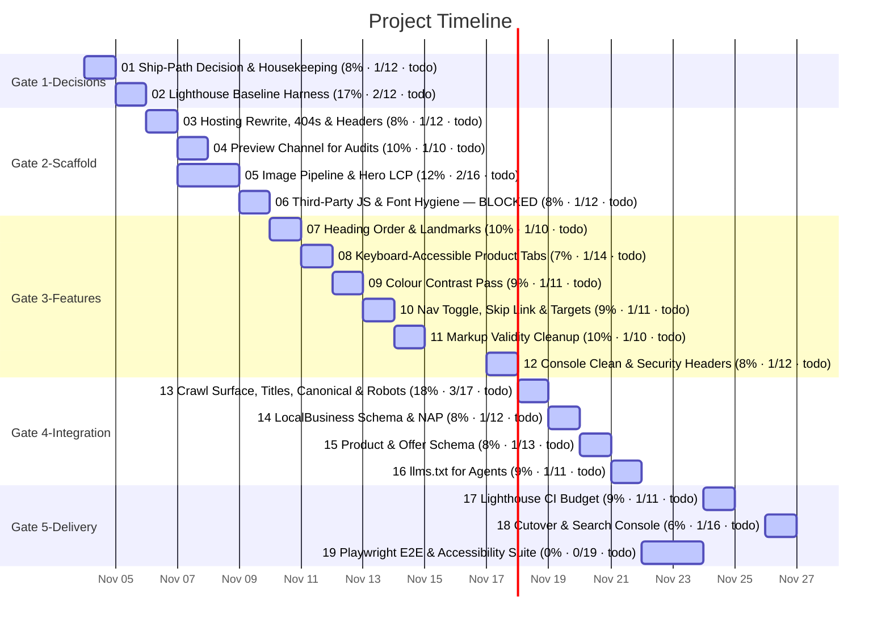

# Task Timeline (Gantt)

_Auto-generated from the draft tasks in `docs/draft_tasks/`. Do not edit by hand._

Open in **[Mermaid Live](https://mermaid.live/edit#pako:eNqVlc9O20AQxl9lZAmUSnHJOv9zIw4USoAIR5VacZnYG3sbZzfaXQcihNSH6Lv03kfpk3Qcx-AeCKkvlj3r3858-834yQlVxJ2BE6O09l4CXVbYlMNEq-88tDAVS54KyYtYhJafK71EC_CVLvf62h2Nihg-ClPGjmZwFN3LImCII5SET_QxMHfEQ2Ho2RTRBoMgESt3gjaBMgbHcKEywxecr4SModY7gt-_gJ0wL79bFakPMAAk8JrXwWt4HZcxt9GqA4t2XA_GIk5sknNgiGZbBlygltwYqLHuFum9h2y_Iv8pxHODEOdzlZb7NSllY_Ns7_iDFpYgrUbL5KVwjLg2B1fRqVTRopPga8EfwE9QSp7CXGk4zSJh8yIaJbGxl9itENtwucSYTlisCknyBLWCsT8hoFeq0nkP6JXADkwToSM6QW038Dkg4LmSFi42seDE__PjJwzHt_7V2ehgCfpvqN50zznaTPPSPd2turnqt5pEpr3HKKMl6sXh8rBGRZ4eXPHNTCEVdBqGZBUxK9ohyvJ2wBlxuyW2tRfLKtg--CpVmaabtBqNhQnmNuyXKLYX5b2iqJYbXMNUxXFKS4KFWJHT5YJKn6KOuT2c2qxQGVyTaNkKvmAqyF0b8FOOkl4cLGOl--h4qVCjSLothpILeJjpnPuf7cC6b3ih5V5Ky2ON-avdtk3wNT6kEGR6jiFRpvk0M3XwUSopQkwpkzs1U9vuKRJonrDu3gR6lbpaMFZEGWZGbOdIECZ8iQS9OZ0cXFHF3az94q1juJ3PycI75CusuQ_mVcxLTZumS_PRPtpiTMRcHm4Hj70hdJtmdkpL9Wa3Tbc6Wv1LGGYR-e7gfao-6YGfWbXedm7AUYfJi3FqnRK3dxZ5lXHJ-jBJcUPjl9KDM--MqGUXizQ3X5DRZIZa4ejGCX2wD-0VY86pO7EWkTOwOuN1Z8npL5c_Ok_PFFqh_KbUsoxqlcWJM5hjaugpW-X_zJFA8uluyfNfBl5A_Q)** (pako/zlib-compressed, verified to round-trip).

Regenerate whenever task metadata changes:

```bash
python3 -m project_management plan gantt --output docs/diagrams/task-gantt.md
```

## Legend

| Bar | Meaning |
|---|---|
| `✓` task | **done** — rendered in the mermaid `done` style |
| plain task | **active** — scheduled work (or in progress) |
| `(50% · 3/6 · doing)` | checkbox progress + status, same format as the dependency graph |

Same design as the dependency graph: every task ends on its deadline (or on the
earliest deadline of the tasks that depend on it); duration comes from the
Estimated Effort. Tasks are grouped into Gate sections. Tasks with no usable
date cannot be drawn as a bar — they are listed under the chart until they get
a **Deadline**. (Mermaid gantt has no 'skipped' row state.)


