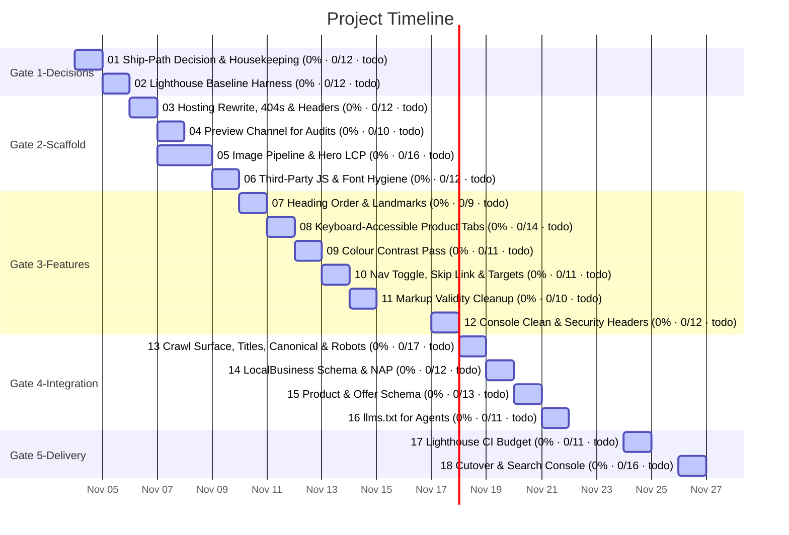

# Task Timeline (Gantt)

_Auto-generated from the draft tasks in `docs/draft_tasks/`. Do not edit by hand._

Open in **[Mermaid Live](https://mermaid.live/edit#pako:eNqVldtO20AQhl9lZAnUSnFrOyfIHTii0AaIcFSpFTcTe2xvY-9Gu-tAhHiu3vfJOs4BzAWp6xtrPetvdv79d_bJiVVCzsjJUFp7L4EfK2xBMNXqF8UWZqKkQkjaxhK0dKF0iRbgBz_u9bU7Hm9j-CjMPnY0h6PkXm4DhjlCSfjCP4PvjikWhsdmG_V8iHKxdKdoc9jH4BguVWVoQbQUMoMP3hH8-Q3eZz-o31Yl6iOMABm8og4EXjBwfd_1eh3wkx03gInIcpvXHDhHsykDLlFLMqY1sf9KfFNH4EYxpqkq9um6vGJj68Xe0YMWliE9r2fqSggT0u1TDhpF9HgjaCXoAcIcpaQCUqXhrEqEbQK9g8BhA9iHqxIz3l-x3ApSr08rmITTBm_wL16w5w1glgud8PZpu4avEfMulLRwuc4EMb5t0afv6Nx1LwhtpWlvl-FGz1rnW82ycr4JyqREvWgIcnool-819DiBb7SeK-QSzuKYnSHmW_cnVe1-nDdl7h3E-g3sKYSqUJXml7QajYUpvnGdfxAVvKJ4b29wBTOVZQVPiRZiycaWCy58hjoj257abVB9uGbJqiV8x0Kwm9YQFoSSP7R0ld84a7y3XKdRrNyGwmuLKK50jf1P9_vDd4zQc6-kpUxj_WmXtguhxocCokqnGDNlVvcu04EQpZIixoJXcqfm6o1Iw4P5Txpl9WCiGHJeGbFpGlGcU4nMvDmbti6o4Wy__-KsY7hNU7bvDvkK6x6CBQ3r8iEtitJ8so922xQyku3NEPjv6NznBl3wVL3epRk2-2h4BedVwq5rnadpkxMIK6tWm1MbEeo4f_FNy94T7Jqj03EyLRJnZHVFHackvnfqofP0zKElyp9KlfuoVlWWO6MUC8OjalnfYmOB7KXdlOe_Zy8fhQ)** (pako/zlib-compressed, verified to round-trip).

Regenerate whenever task metadata changes:

```bash
python3 -m project_management plan gantt --output docs/diagrams/task-gantt.md
```

## Legend

| Bar | Meaning |
|---|---|
| `✓` task | **done** — rendered in the mermaid `done` style |
| plain task | **active** — scheduled work (or in progress) |
| `(50% · 3/6 · doing)` | checkbox progress + status, same format as the dependency graph |

Same design as the dependency graph: every task ends on its deadline (or on the
earliest deadline of the tasks that depend on it); duration comes from the
Estimated Effort. Tasks are grouped into Gate sections. Tasks with no usable
date cannot be drawn as a bar — they are listed under the chart until they get
a **Deadline**. (Mermaid gantt has no 'skipped' row state.)


