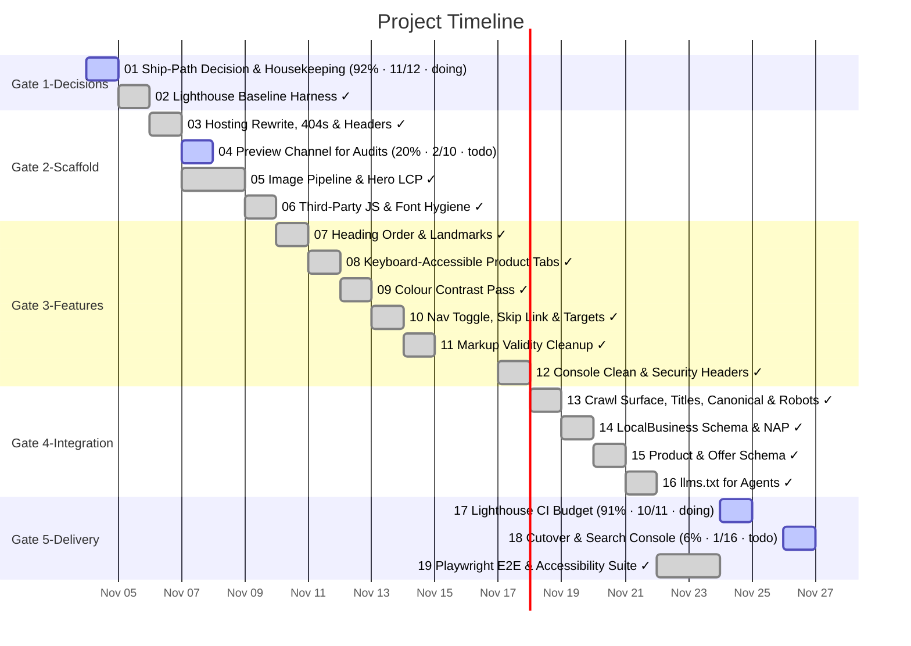

# Task Timeline (Gantt)

_Auto-generated from the draft tasks in `docs/draft_tasks/`. Do not edit by hand._

Open in **[Mermaid Live](https://mermaid.live/edit#pako:eNp9VUtu2zAQvcpAQIIUsGpR_sXeJXLSpHUSIzIKtMhmLNESa5k0SMqJEeQU3fYe3fcoPUlHlp2ogBRtZHL0Ht_MPI6fnUjF3Bk5CUprHyTQY4XNOEy1-sEjCzOx4pmQvIzFaPml0iu0AN_ocW9u3PG4jOGTMIfY0RyO4gdZBgzxCCXhE4GBuWMeCUNrU0Y9BmEq1u4UbQqHGBzDlcoNX3K-FjKBk6F_BH9-A2Nt5hc_YkXbH2AESNwb3gLf8_suY67XbQGL99Q-TESS2rSggnM0u0zgCrXkxsDfXz-JIFayCu-9wf_T7bthhIuFyg7cHVJobCHunj9qYYmk63VNoZxjzHUDf78ir0tV5hvBHyFIUUqewUJpOMtjYQ2c-N4uZb_NvOJtVaxqEx5UGHtwvcKEuifWZa6FGq1gEkzr5RDYP4D7MEuFjqkT2m7hc0jgSyUtXG0TwYmrlmDYUK-Oe8nR5pof2jzY1aWo152m8hD5BGW8Qr2srxTzKnmdwhe-nSskdWdRRM0T89KjcV54FOcNHKzCMYRAZSrX9JJWo7EwxQYXMP8NR9W_xQ3MVJJk9Em4FGtylVxSAjPUCbcNFJ0KBYMbyjNfw1fMBHV3C0HGUdJGLbRiYXI7yTWKst1B6NSQR7kuON7zGRs09KXrXkvLE43F1v6MDgQaHzMIc73AiFhmxQgwLQhQKikizOjYezVXTbmeVgR3YaIIcZ4bsbtlYZTyFRLB7Vm9B1nFQqz32tRjuFssyCd7fB3Sr1iE9SHLVuajfbLlLUq4bJDrs4ba9Gg2ZXS59HbPOajOj-AazvOYGk7TiJXTyGtTa9-bRn61lacQ5FZtdt4POeoofe3tSb8kbFMa79x1vzI92BCmGW5p9JBCuPAviPVwN0RW-CPMaSrVV8Avr73TchItYmdkdc5bzorT9C6WzvMLhdYovyu1OkS1ypPUGS0wM7TK18V_wVggWWn_ycs_oJ_s2A)** (pako/zlib-compressed, verified to round-trip).

Regenerate whenever task metadata changes:

```bash
python3 -m project_management plan gantt --output docs/diagrams/task-gantt.md
```

## Legend

| Bar | Meaning |
|---|---|
| `✓` task | **done** — rendered in the mermaid `done` style |
| plain task | **active** — scheduled work (or in progress) |
| `(50% · 3/6 · doing)` | checkbox progress + status, same format as the dependency graph |

Same design as the dependency graph: every task ends on its deadline (or on the
earliest deadline of the tasks that depend on it); duration comes from the
Estimated Effort. Tasks are grouped into Gate sections. Tasks with no usable
date cannot be drawn as a bar — they are listed under the chart until they get
a **Deadline**. (Mermaid gantt has no 'skipped' row state.)


