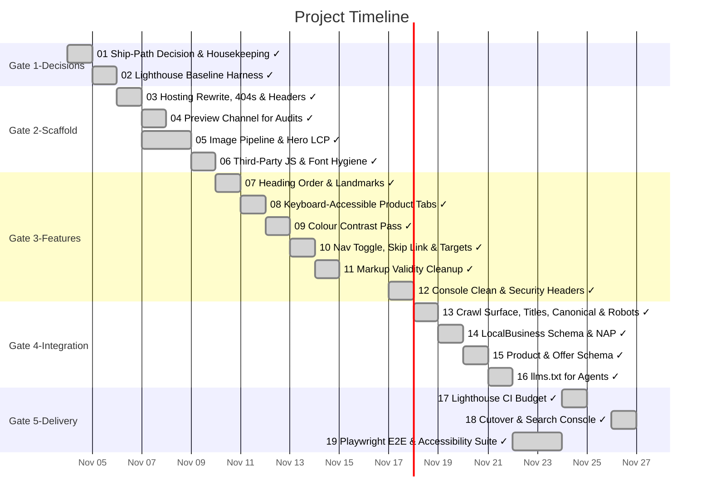

# Task Timeline (Gantt)

_Auto-generated from the draft tasks in `docs/draft_tasks/`. Do not edit by hand._

Open in **[Mermaid Live](https://mermaid.live/edit#pako:eNp9VNtO20AQ_ZWRJXiKq6xzg7yBA4U2QISjSq14mdgTe5vNbrReByLEV_S1X9cv6ThOwJXs-sVaj8-Zyzk7r15sEvLGXorauScN_DjpFMHMmp8UO5jLNSmpqYol6Oja2DU6gO_8-Hd3_mRSxfBF5sfYyQJOkiddBXLmkUbDZwaD8CcUy5zPeRXtCogyufFn6DI4xuAUbkyR04poI3UKf37_gjEkRlMHgm4w9IXwu_0OiORAEsBUppnLShBcYr6vGW7QasrzZvjgA_5PhYEfxbhcGnXk7nEtuSvLeKRnKx2T9Lv9vKyRMCHbwj-sldfnedJW0jOEGWpNCpbGwkWRSNeCHtXQA7hdY8qayE3VV5nZGpiGs1ZwcAQPYZ5Jm_B8rdvBl4jB10Y7uNmlkpirkeC8ZTY9_5rQFZaO4o32Myhn82B5FEw-RZ2s0a6a-xLdWl9n8JV2C4Nc3UUcs1ByUTkvKUrn4aKFQ9Q4ziE0yhSWX9pZzB3MsEVxEXzgRBfucQtzk6aKf4lWcsMO0ituYI42pRZZRK9GIeCO-yw28A2VZCV3ECpCzR8aoTW7iqAsNzfc7R7CWSOKC1ty_M9TYtSiS9-_1Y5Si-WnQ44ehBafFUSFXWLMLPPyYucdCFEbLWNUnPbRLExbr2e1gvswNYy4LHK5v1FRnNEameD-otmDomYhMXgX9RQelkv2yQHfhAxqFhFDUGqdf3IvrroxKemWcgPRMpsBbxwlt2R3B85RfVeEt3BZJCx4M2ldtDMIC2e2e5dHhDbO3lVsxNYWgDiHmcIdbw9ODFfBFVMcLS9VKXtU8GJp5gmq2-x1vNTKxBs7W1DHWxOv2vLovb5xaIP6hzHrY9SaIs288RJVzqdiUy7uiUR2yOGXt79r49W6)** (pako/zlib-compressed, verified to round-trip).

Regenerate whenever task metadata changes:

```bash
python3 -m project_management plan gantt --output docs/diagrams/task-gantt.md
```

## Legend

| Bar | Meaning |
|---|---|
| `✓` task | **done** — rendered in the mermaid `done` style |
| plain task | **active** — scheduled work (or in progress) |
| `(50% · 3/6 · doing)` | checkbox progress + status, same format as the dependency graph |

Same design as the dependency graph: every task ends on its deadline (or on the
earliest deadline of the tasks that depend on it); duration comes from the
Estimated Effort. Tasks are grouped into Gate sections. Tasks with no usable
date cannot be drawn as a bar — they are listed under the chart until they get
a **Deadline**. (Mermaid gantt has no 'skipped' row state.)


