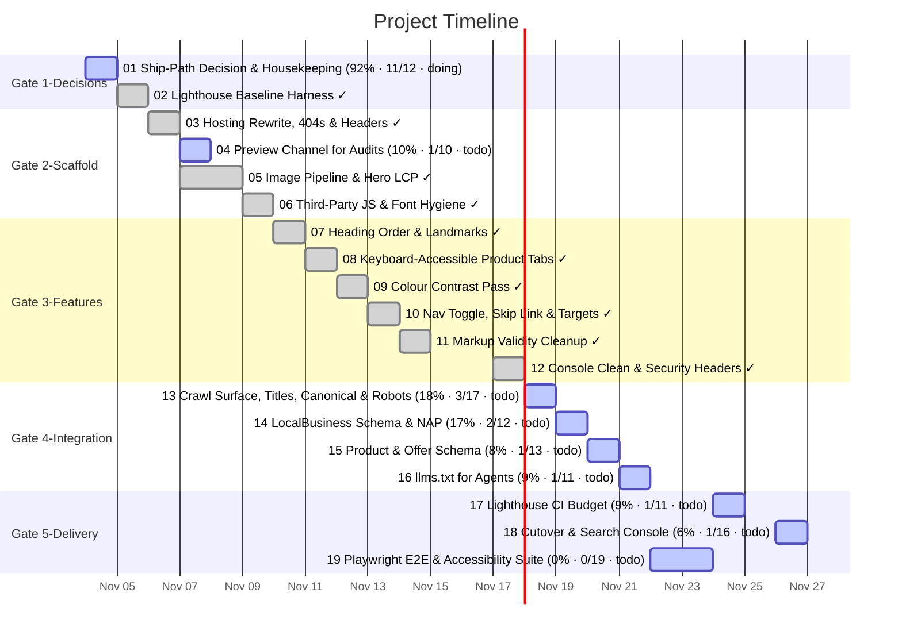

# Task Timeline (Gantt)

_Auto-generated from the draft tasks in `docs/draft_tasks/`. Do not edit by hand._

Open in **[Mermaid Live](https://mermaid.live/edit#pako:eNqNlc1um0AQx19lhJTIlUzN4m_fEtw0aZ3EClalVrmMYQ3b4F1rd3FiRXmKXvsevfdR-iQdjEmoZFvlAsswv52P_w7PTqRi7oycBKW19xLossJmHKZafeeRhZlY8kxIXtpitPxC6SVagK90udfX7nhc2vBJmMp2MoeT-F6WBkMcoSR8JGdg7phHwtDalFaPQZiKlTtFm0Jlg1O4VLnhD5yvhEygMfRP4PcvYKzF_OIhVvT6HYwAib3mTfA9v-cy5nqdJrB4h_ZhIpLUpgUKztFsM4FL1JIbA39-_iBArGTdvfvm_k_cvhtGuFiorGK3KUJji-Du-KMWliAdr2OKyDnGXB_g92rhdajKfC34IwQpSskzWCgNZ3ksrIEG88qUW8wr7lbFam_C_RqxC1dLTKh7YlXmWkSjFUyC6f5wyNmvnHswS4WOqRPabuBTSM4XSlq43CSCE2svYHigXm33gqPNNa_a3N_WpajXrabyEHyCMl6ifthfKebV8hrAZ76ZK6TozqKImifmpUbjvNAozg8wWI0xhEBlKtd0k1ajsTDFAypg_psfVf8G1zBTSZLRJ-GDWJGq5AMlMEOdcHsA0a4hGFxTnvkKvmAmqLsbCDKOkl7sda1JmNRO4RpF2W5daNeQR7kuGMd0xvoH-tJxr6Tlicbi1W6PNgQaHzMIc73AiCizYgSYJgQolRQRZrTtnZqrrSwHW1m2W6x_TJZsUEuiAxNFlPPciO3JC6OUL5GgN2dTIva3RH93tA8Sa1Jj3dfmn8LtYkF62jEbg-rUtI_B_Jq6WA-ybGne2ydbHsCEyyLTYUViR0nsQKW7NOky-lRvdtv069MouILzPCb5_Pc-dVUMIMitWm-PUchRR-mrTBq9Ctc7iqsNIjaEaYYbmmIUHnzwPxC1OmYiK6QW5jTgoFFOJK9FDsfQfjlUnKaTaBE7I6tz3nSWnP4NxdJ5fiHTCuU3pZaVVas8SZ3RAjNDq3xV_GnGAkmou09e_gK-Fgdn)** (pako/zlib-compressed, verified to round-trip).

Regenerate whenever task metadata changes:

```bash
python3 -m project_management plan gantt --output docs/diagrams/task-gantt.md
```

## Legend

| Bar | Meaning |
|---|---|
| `✓` task | **done** — rendered in the mermaid `done` style |
| plain task | **active** — scheduled work (or in progress) |
| `(50% · 3/6 · doing)` | checkbox progress + status, same format as the dependency graph |

Same design as the dependency graph: every task ends on its deadline (or on the
earliest deadline of the tasks that depend on it); duration comes from the
Estimated Effort. Tasks are grouped into Gate sections. Tasks with no usable
date cannot be drawn as a bar — they are listed under the chart until they get
a **Deadline**. (Mermaid gantt has no 'skipped' row state.)


