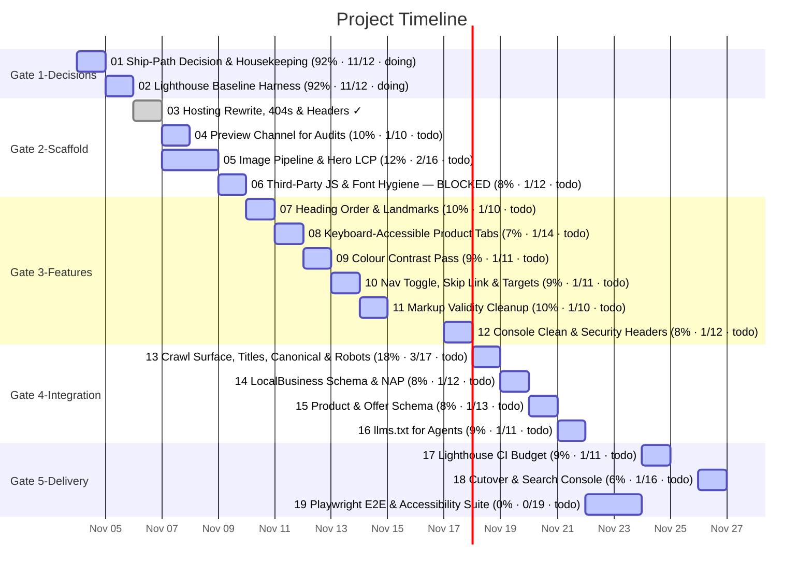

# Task Timeline (Gantt)

_Auto-generated from the draft tasks in `docs/draft_tasks/`. Do not edit by hand._

Open in **[Mermaid Live](https://mermaid.live/edit#pako:eNqVlc9O20AQxl9lZAmUSnHjdf4BN3CgUAJEOKrUqpeJvbG3cXaj3XUgQkh9h_bY9-i9j8KTdBzH4EolTX2x12P_9pvxN-MHJ1Ixd46cBKW1nyXQYYXNOIy0-sIjC2Mx55mQvIzFaPmZ0nO0AB_pcK-u3MGgjOG9MFVsbwJ78WdZBgxxhJLwjl4G5g54JAytTRn1GISpWLgjtClUMdiHc5UbPuN8IWQCjUN_D379BMZazC8uYkW338ARILGXvAm-5_dcxlyv0wQWb9A-DEWS2rRAwQmadSZwjlpyY_4H2n2B_pGN74YRTqcqq3Zsk25jC8m3_E4LS5CO1zFFPhxjrg08_fhGO8RK1vm9mugO1Z4vBb-DIEUpeQZTpeE4j4UlzcwrNbeYV5ytitVfFfdrxC5czDGhbyoWZQUKNVrBMBgRsCyC32K9fwH9CtiDcSp0TN9M2xW8Dwl4pqSF81UiOPGfvn6Hk-FNcHk6gMZBJdjfyj98pcRt94yjzTWv_NJfl7Io8Y2mitLeQ5TxHPVs9_Iwr1aeA7jkq4lCSug4isgZYlI2QJwXDYAT4vYrbGcrltWwhxCoTOWaTtJqNBZGuHZdhWJbUf4LinK5xiWMVZJk9Eg4EwsytpxR6mPUCbe7U9s1KoMrKlq-gA-YCXLXCoKMo6QbO5ex1mz0eSlRo6h0awyJC3mU64JbeX9HL7D-K17ouBfS8kRjcWuzbRsCjXcZhLmeYkSUcTG_TBMClEqKCDNScqsmat09pYB2i_W3Cjio5dWBoSLKSW7EemyEUcrnSNDr49HOGdXczbrP3tqHm-mULLxBvsDa22B-zbzUtFk2N2_tvS3HRMLl7nbw2SuF7tKUzuhRvdps069P0uACTvKYfLfzPnWfHECQW7Vcd27IUUfps3EavQq3dRb5tXHJDmGU4YpmLcmDU_-UqFUXi6wwX5jTGIZG6WivRS9sQ_vlmHOaTqJF7BxZnfOmM-f0XyuWzsMjhRYoPyk1r6Ja5UnqHE0xM7TKF8VfciCQfLp55PE3N5M87A)** (pako/zlib-compressed, verified to round-trip).

Regenerate whenever task metadata changes:

```bash
python3 -m project_management plan gantt --output docs/diagrams/task-gantt.md
```

## Legend

| Bar | Meaning |
|---|---|
| `✓` task | **done** — rendered in the mermaid `done` style |
| plain task | **active** — scheduled work (or in progress) |
| `(50% · 3/6 · doing)` | checkbox progress + status, same format as the dependency graph |

Same design as the dependency graph: every task ends on its deadline (or on the
earliest deadline of the tasks that depend on it); duration comes from the
Estimated Effort. Tasks are grouped into Gate sections. Tasks with no usable
date cannot be drawn as a bar — they are listed under the chart until they get
a **Deadline**. (Mermaid gantt has no 'skipped' row state.)


