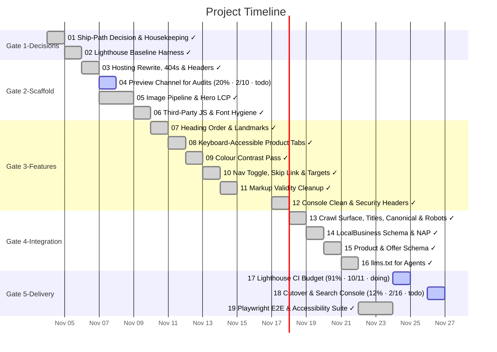

# Task Timeline (Gantt)

_Auto-generated from the draft tasks in `docs/draft_tasks/`. Do not edit by hand._

Open in **[Mermaid Live](https://mermaid.live/edit#pako:eNp9VNtum0AQ_ZURUqJUMo2X-BL7LcFJk9ZJrGBVapWXMaxha9i1dhcnVpSv6Gv_o-_9lH5JB2MSKkF4gWU4hzMzZ-bZCVXEnbETo7T2QQJdVtiUw0yrHzy0MBcZT4XkZSxCyy-VztACfKPLvblxJ5Myhk_CVLGDBRxED7IMGOIRSsInAgNzJzwUhs6mjHYZBIlYuzO0CVQxOIQrlRu-4nwtZAx_f_2EMURK8g54XW_gMuZ2ex1g0Z7Eg6mIE5sUIDhHs9MMV6glN6YZ3n-D_6fQc4MQl0uVVtwnpMXYQsY9f9TCEkmv2zOFRo4R1y38g5q8HtWTbwR_BD9BKXkKS6XhLI-ENXDkdQ_gz2_wjlm3uFsVqQ_EhyRqU2cc1hj7cJ1hTH0S6zLXQo1WMPVnzXII7FXgAcwToSOqubZb-BwQ-FJJC1fbWHDiaiQYtdTrxL3kaHPNq4YOd3Up6nWnqTxEPkUZZahXzZVi3Vpep_CFbxcKSd1ZGFLzxKJ0Y5QXbsRFCwercYzAV6nKNd2k1WgszLDFBcx7w1H1b3EDcxXHKX0SrMSaXCVXlMAcdcxtC8VJjYLBDeWZr-ErpoK6uwU_5SjpRSO0ZmHmFXKNomx3EPprwMNcFxzv-YwNW_rSc6-l5bHG4tX-Hyfga3xMIcj1EkNimRfDbjrgo1RShJjSb-_VQrXleloT3IOpIsR5bsRuyoIw4RkSwe1ZswdZzUKs_9rUQ7hbLskne3wT0qtZhA0gTTPz0T7ZcopiLlvkeqylNn3aQikNl97uOYf1_eFfw3keUcPhaMR2o8m6x9RaeogU-bppOL16K0_Bz63a7LwfcNRh8trbI-ZVwz54b9i92vpgI5iluKXdQxLhwrsg2mo4RFoYJMhpLTWXwCvn3uk4sRaRM7Y65x0n47Soi6Pz_EKhNcrvSmVVVKs8TpzxElNDp3xdrP2JQPLS_pOXf3Ib5uk)** (pako/zlib-compressed, verified to round-trip).

Regenerate whenever task metadata changes:

```bash
python3 -m project_management plan gantt --output docs/diagrams/task-gantt.md
```

## Legend

| Bar | Meaning |
|---|---|
| `✓` task | **done** — rendered in the mermaid `done` style |
| plain task | **active** — scheduled work (or in progress) |
| `(50% · 3/6 · doing)` | checkbox progress + status, same format as the dependency graph |

Same design as the dependency graph: every task ends on its deadline (or on the
earliest deadline of the tasks that depend on it); duration comes from the
Estimated Effort. Tasks are grouped into Gate sections. Tasks with no usable
date cannot be drawn as a bar — they are listed under the chart until they get
a **Deadline**. (Mermaid gantt has no 'skipped' row state.)


