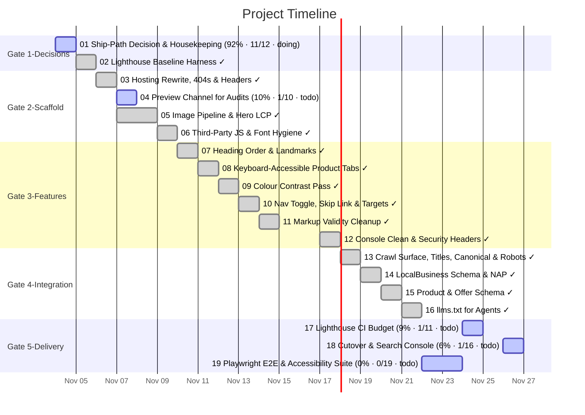

# Task Timeline (Gantt)

_Auto-generated from the draft tasks in `docs/draft_tasks/`. Do not edit by hand._

Open in **[Mermaid Live](https://mermaid.live/edit#pako:eNp9VUtu2zAQvcpAQAIXsBpR8Sf2LpGTJq2TGJFRoEU2Y4mWWMukQVJOjCCn6Lb36L5H6Uk6sqxEBSxrI5Oj9_hm5nH84kQq5s7QSVBa-yiBHitsxmGi1Q8eWZiKJc-E5GUsRsuvlF6iBfhGj3t7645GZQyfhaliRzM4ih9lGTDEI5SETwQG5o54JAytTRn1GISpWLkTtClUMTiGa5UbvuB8JWQCrYF_BH9-A2MnzC9-xIq2P8AQkLjXvA2-5_dcxlyv0wYW76h9GIsktWlBBRdotpnANWrJjYG_v34SQaxkHd59h_-n23fDCOdzlVXcp6TQ2ELcA3_SwhJJx-uYQjnHmOsG_l5NXoeqzNeCP0GQopQ8g7nScJ7HwhpoMa9M-YR5xduqWO1NuF9j7MLNEhPqnliVuRZqtIJxMNkvh8B-Be7BNBU6pk5ou4HPIYGvlLRwvUkEJ669BIOGep26VxxtrnnV5v62LkW97jWVh8jHKOMl6sX-SjGvltcZfOGbmUJSdx5F1DwxKz0a54VHcdbAwWocAwhUpnJNL2k1GgsTbHAB899xVP07XMNUJUlGn4QLsSJXyQUlMEWdcNtAcVqjYHBLeeYr-IqZoO5uIMg4StrYC61ZmNxOco2ibLcQOjXkUa4LjkM-Y_2GvnTcG2l5orHY2p1xCoHGpwzCXM8xIpZpMQJMGwKUSooIMzr2Qc1UU65nNcEdGCtCXORGbG9ZGKV8iURwd77fg6xmIdZ9a-ox3M_n5JMdfh_Sr1mE9SDLluajfbblLUq4bJDrs4badGk2ZXS59GbH2a_Pj-AGLvKYGk7TqLqZ7NDN9Ot9PIMgt2q9NX7IUUfpW2NbvYqud5CuNjrYACYZbmjukDy49C-JtboYIivMEeY0kqBVzhDvhACHqP1yDDhtJ9EidoZW57ztLDlN82LpvLxSaIXyu1LLKqpVnqTOcI6ZoVW-Kv4bRgLJWrtPXv8BZW_xdg)** (pako/zlib-compressed, verified to round-trip).

Regenerate whenever task metadata changes:

```bash
python3 -m project_management plan gantt --output docs/diagrams/task-gantt.md
```

## Legend

| Bar | Meaning |
|---|---|
| `✓` task | **done** — rendered in the mermaid `done` style |
| plain task | **active** — scheduled work (or in progress) |
| `(50% · 3/6 · doing)` | checkbox progress + status, same format as the dependency graph |

Same design as the dependency graph: every task ends on its deadline (or on the
earliest deadline of the tasks that depend on it); duration comes from the
Estimated Effort. Tasks are grouped into Gate sections. Tasks with no usable
date cannot be drawn as a bar — they are listed under the chart until they get
a **Deadline**. (Mermaid gantt has no 'skipped' row state.)


